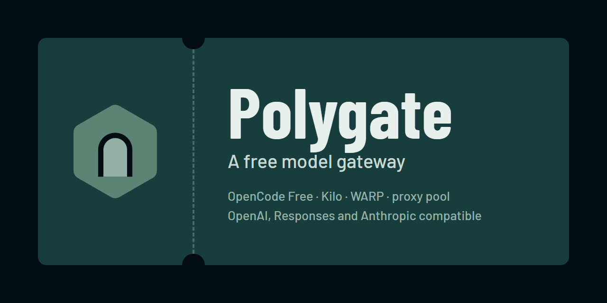
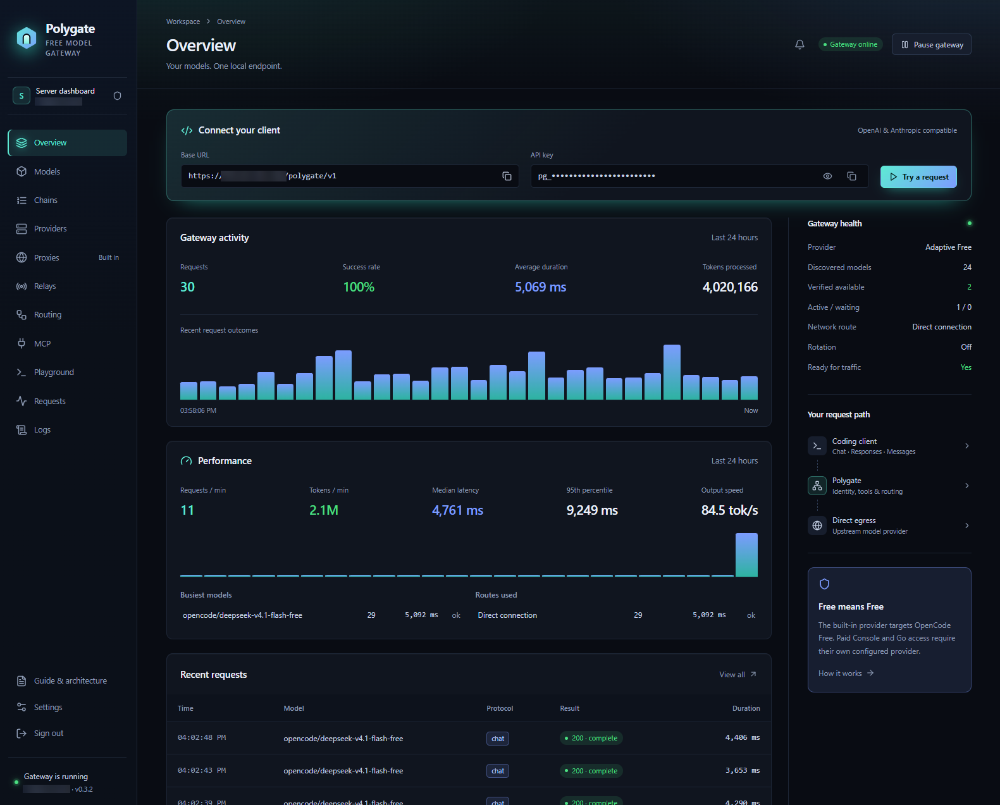
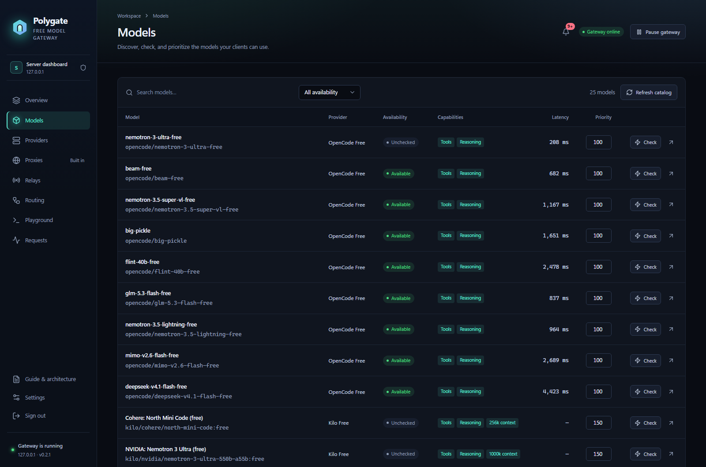
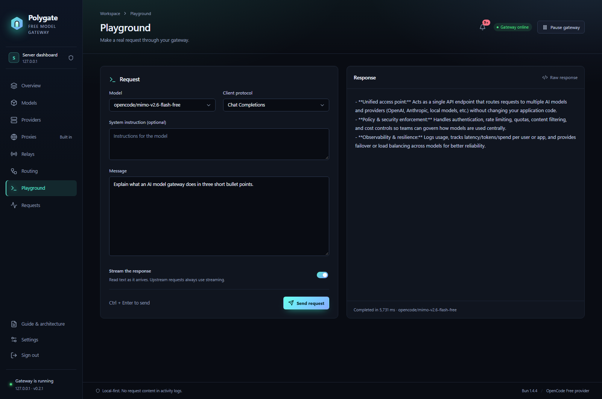
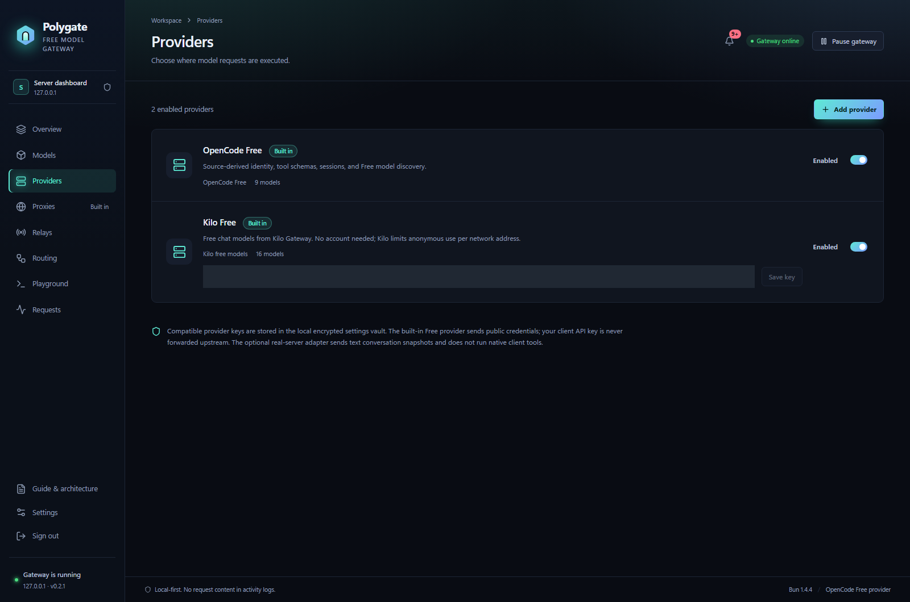
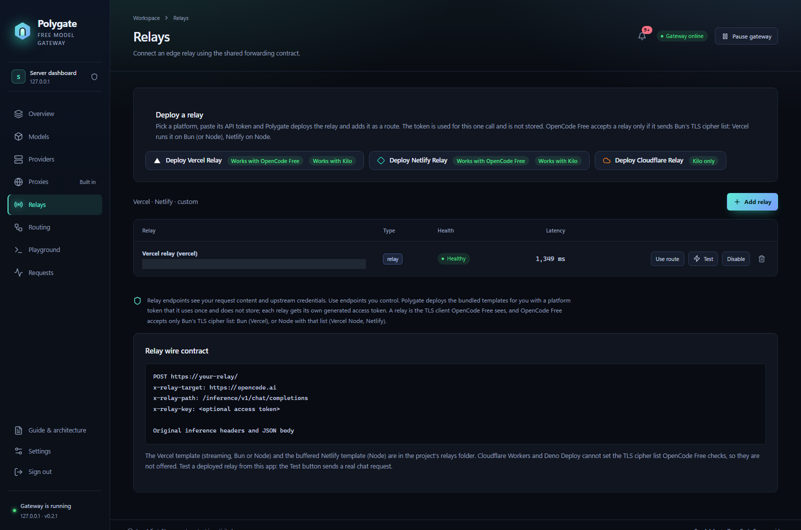
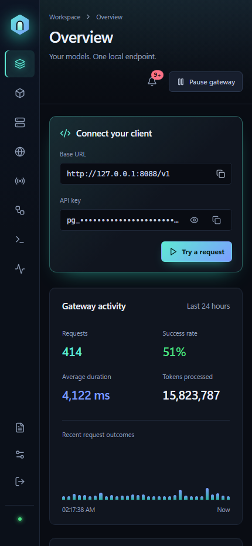

<p align="center">
  
</p>

<p align="center">
  <a href="https://github.com/B3hnamR/Polygate/releases/latest"></a>
  <a href="https://github.com/B3hnamR/Polygate/actions/workflows/ci.yml"></a>
  <a href="LICENSE"></a>
  
</p>

<h1 align="center">Your models. One endpoint.</h1>

<p align="center">
  Connect your AI tools to free models through a gateway you control.<br>
  Switch providers, manage network routes, and see every request from one dashboard.
</p>

<p align="center">
  <a href="#quick-start"><b>Install Polygate</b></a> ·
  <a href="#dashboard-showcase">See the dashboard</a> ·
  <a href="#connect-your-client">Connect a client</a> ·
  <a href="https://github.com/B3hnamR/Polygate/releases/latest">Downloads</a>
</p>



## Why Polygate?

| | What you get |
|---|---|
| **Free providers, built in** | OpenCode Free and Kilo Free. Discover their current catalogs, or add your own compatible API. |
| **One address for your tools** | OpenAI Chat Completions, OpenAI Responses, and Anthropic Messages endpoints. |
| **Automatic model selection** | Use `auto`, `auto:smart`, or `auto:fast`; Polygate can try another model when one is busy or rate-limited. |
| **Control your connection** | Direct access, HTTP/SOCKS proxies, a verified proxy pool (from public lists or your own list links), WARP, and deployable relays. |
| **One MCP address for your tools** | Add MCP servers once; every AI client gets all their tools from `/mcp` with its Polygate key, reached through your own routes. |
| **See what is happening** | Model availability, request timing, a searchable log of everything the gateway does, client keys, and a Playground for real requests. |
| **Run it your way** | Portable Windows app, Linux service with a manager, or Docker. Built-in HTTPS is available on servers. |

> [!NOTE]
> Free models have provider limits and changing availability. Polygate helps you manage access; it cannot guarantee capacity or remove provider limits. Follow each provider’s terms.

## Quick start

### Linux server

**Copy these two commands into your server’s terminal:**

```bash
curl -fsSL https://raw.githubusercontent.com/B3hnamR/Polygate/main/install.sh -o install.sh
sudo bash install.sh
```

1. Press **Enter** to start. The installer checks the machine and installs missing dependencies.
2. Choose how to open the dashboard: a domain, the server’s IP with HTTPS, your existing web server, your own certificate, or a local SSH tunnel.
3. Review the plan and confirm. Open the **Dashboard** address shown at the end and sign in with the supplied password.

Run **`polygate`** any time to open the server manager.

> [!TIP]
> The `curl` command is silent when it succeeds: it saves `install.sh`. The second command starts the installer.
> To check the machine first, run `sudo bash install.sh --check`.

**Requirements:** Linux with systemd and glibc, on x86-64 or ARM64. Ubuntu, Debian, Fedora/RHEL, Arch, and openSUSE families are supported. Alpine and environments without systemd should use Docker. ARM64 packages are built in CI; running them on ARM64 hardware has not yet been verified.

<details>
<summary><b>Advanced install options, HTTPS choices, and server changes</b></summary>

The installer opens with the Polygate banner and waits for you to press Enter. Then it checks the machine and installs what is missing in one quiet step (details go to `/var/log/polygate-install.log`; only problems are shown), asks how you want to open the dashboard, shows a short summary and asks once more before it installs. It needs systemd and glibc (Alpine and containers without systemd should use Docker). When it finishes, run `polygate` any time to open the manager.

**What it checks:** your Linux version and CPU, free disk space and memory, the clock, internet access, which tools are missing (it installs only those, and nothing is upgraded), whether ports 80 and 443 are already used and by which program, and whether anything on the machine would clash with the names it uses.

**It does not disturb your other services.** It never stops, restarts or edits another service, and it never changes your firewall. It only creates `/opt/polygate`, `/etc/polygate`, `/var/lib/polygate`, a `polygate` system user, `polygate.service` and the `polygate` command. If any of those names already belong to something else, it stops and changes nothing.

**It asks how you want to open the dashboard:**

| Choice | What you get | Needs |
|---|---|---|
| A domain name, with automatic HTTPS | `https://your.domain/polygate/` with a free Let's Encrypt certificate that renews itself | the domain points at the server; ports 80 and 443 free |
| The server's IP address, with automatic HTTPS | `https://1.2.3.4/polygate/` with a free short-lived certificate that renews itself | a public IPv4 address; ports 80 and 443 free |
| Behind the web server I already run | Polygate listens on `127.0.0.1` only; a ready-made nginx and Caddy snippet is shown | your own web server |
| My own certificate files | HTTPS with your certificate, on port 443 or another port you choose | certificate and key (PEM) |
| No HTTPS | listens on `127.0.0.1` only; open it through an SSH tunnel | nothing |

Automatic HTTPS needs ports 80 and 443 for good (80 for renewals and the redirect, 443 for the dashboard). If another program already holds them,
the installer says which one and shows the command to stop it permanently, or you pick *behind the web server I already run* and nothing is stopped.
If a firewall is active it only prints the commands you may want to run; open the same ports in your hosting provider's panel if it has its own firewall.

**Without questions** (for scripts), anything you do not give takes the safe default (local only):

```bash
sudo bash install.sh --yes --https domain --domain panel.example.com --email you@example.com
sudo bash install.sh --yes --https ip
sudo bash install.sh --yes --https proxy --domain panel.example.com
sudo bash install.sh --yes --https custom --cert fullchain.pem --key privkey.pem --https-port 8443
sudo bash install.sh --update      # newer release, keeps your data, settings and certificates
```

`bash install.sh --help` lists every option. The dashboard is served at `/polygate/` (set `POLYGATE_DASHBOARD_PATH` to another path, or to an empty value for the root), so on a shared domain only that one path belongs to Polygate. The password is shown once at the end and kept in `/var/lib/polygate/admin-password.txt`.

</details>

### Windows

1. **[Download the Windows app](https://github.com/B3hnamR/Polygate/releases/latest)** — choose `Polygate-<version>-Windows-x64.exe`.
2. Run it. It is portable: no installer or administrator access is needed.
3. The dashboard opens inside the app. Copy your connection details into an AI tool, or try the **Playground**.

The API stays at `http://127.0.0.1:4317/v1` from one launch to the next (if another program holds that port, the app picks a free one once and keeps it). Closing the window keeps Polygate running in the tray so your tools keep working; right-click the tray icon and choose **Exit** to stop it, or turn this off in **Settings → Desktop app**.

The app is currently unsigned, so Windows may show SmartScreen. Download from this repository’s release page and verify the executable against the supplied `.sha256` file. App data is kept in `%LOCALAPPDATA%\Polygate`.

### Docker

From a machine with Docker Compose and Git:

```bash
git clone https://github.com/B3hnamR/Polygate.git
cd Polygate
docker compose up -d --build
```

Open **[http://127.0.0.1:4317](http://127.0.0.1:4317)**. Retrieve the generated dashboard password with:

```bash
docker compose exec polygate cat /data/admin-password.txt
```

To choose your own password before the first start, set `POLYGATE_ADMIN_PASSWORD` in your shell or a local `.env` file. Docker publishes port 4317 on loopback only and keeps data in a named volume.

<details>
<summary><b>Docker with built-in HTTPS</b></summary>

```bash
docker compose -f docker-compose.yml -f docker-compose.https.yml up -d --build
```

This also publishes ports 80 and 443. Enable HTTPS in **Settings**; both ports must be free and reachable. For an existing reverse proxy, keep the default Compose file and forward requests to Polygate.

</details>

## Dashboard showcase

Real screenshots from **Polygate v0.2.1 running in WSL**. Model availability and activity reflect that workspace at capture time. Credentials stay hidden; private relay addresses are masked.

### Find a model and set its priority

See both providers in one catalog, check availability, compare latency, and choose which models run first.



### Try a request before configuring your tools

Choose a model and protocol, add a system instruction, and read the streamed response beside your request.



<details>
<summary><b>More views: providers, relays, and mobile</b></summary>

**Providers** — built-in free providers and your own compatible endpoints.



**Relays** — deploy to your own account, test the connection, and select a route.



**Mobile** — check your gateway from a smaller screen.

<p align="center"></p>

</details>

## Explore

[Client setup](#connect-your-client) · [Providers](#providers) · [MCP hub](#mcp-hub) · [Network routes and relays](#network-routes-and-relays) · [HTTPS](#https-and-domains) · [Server manager](#managing-a-server) · [Privacy](#privacy-and-access-control) · [Troubleshooting](#troubleshooting) · [Development](#development)

---

## Connect your client

Open **Overview → Connect your client**. Copy the base URL and client API key into your tool, then set the model to **`auto`**. The API key starts with `pg_`; it is different from your dashboard password.

> [!TIP]
> The Windows app and Linux installer can choose a free port. Copy the address from your own dashboard instead of assuming port 4317.

| | |
|---|---|
| Base URL | `http://127.0.0.1:<port>/v1` on your computer, or `https://your.domain/polygate/v1` on a server (`/v1` also works at the root) |
| API key | one of the keys on the Overview page (they start with `pg_`) |
| OpenAI Chat | `POST /v1/chat/completions` |
| OpenAI Responses | `POST /v1/responses` |
| Anthropic Messages | `POST /v1/messages` (send the key as `x-api-key` or as a Bearer token) |
| Model list | `GET /v1/models` |

```bash
curl http://127.0.0.1:4317/v1/chat/completions \
  -H "Authorization: Bearer pg_your_key" -H "Content-Type: application/json" \
  -d '{"model":"auto","messages":[{"role":"user","content":"Say hello"}],"stream":true}'
```

```python
from openai import OpenAI
client = OpenAI(base_url="http://127.0.0.1:4317/v1", api_key="pg_your_key")
print(client.chat.completions.create(model="auto", messages=[{"role": "user", "content": "Hi"}]).choices[0].message.content)
```

**Choosing a model**

| `model` | Meaning |
|---|---|
| `auto` | highest-ranked usable model, with fallback attempts for supported failure types |
| `auto:smart` | prefers reasoning and larger models |
| `auto:fast` | prefers the models that answered fastest |
| `kilo/kilo-auto/free`, `opencode/<name>` | an exact model: the provider, then its model id (see `/v1/models`) |

Your client’s key is never sent to a provider. Streaming and tool support depend on the selected provider and model. Manage client key limits, expiry, and model allowlists in **Settings**.

Responses continuation through `previous_response_id` is not implemented; send conversation input explicitly. The real OpenCode server adapter supports text conversations rather than native tool execution.

---

## Providers

| Provider | What it is | Good to know |
|---|---|---|
| **OpenCode Free** | built in | OpenCode has a daily allowance per network address. When an address is used up, Polygate moves to another exit if you have one, and says when the limit resets. |
| **Kilo Free** | built in; every model Kilo marks free, no account needed | Kilo limits anonymous use per network address. When that happens all Kilo models rest for 30 minutes (the answer says so and carries `Retry-After`). A single busy model rests for 2 minutes while the others keep working. You can save a Kilo API key on its row. Kilo models rank behind OpenCode's in `auto` and take over when OpenCode's are resting. |
| **OpenAI-compatible** | add any endpoint that has `/v1/chat/completions` | needs a base URL and, usually, a key |
| **OpenCode server** | an OpenCode you run yourself (`opencode serve`), reached over its own REST API | uses the providers and logins configured in that OpenCode; model ids are `provider/model` as that server lists them; text conversation only (no tool calls) |

Built-in providers can be switched off but not deleted. A model's priority and score can be changed on the Models page, which can also show one provider's models at a time. Models are not probed in the
background by default (a probe is a real request that uses up allowance); press *Check* on a model to test it.

## MCP hub

Add your MCP servers once on the **MCP** page; every AI client then connects to one address and gets all their tools, named `server__tool`, plus a few of Polygate's own (`polygate__gateway_status`, `list_models`, `list_routes`, `test_route`, `recent_errors`, `read_logs`, `list_mcp_servers`).

```bash
claude mcp add --transport http polygate http://127.0.0.1:4317/mcp --header "Authorization: Bearer pg_your_key"
```

The page has ready-to-paste settings for Claude Code, Cursor, Codex, OpenCode, VS Code and Claude Desktop, and can import the `mcpServers` block other tools use. `/mcp/<name>` offers one server alone, with its tools' own names.

- **Remote servers** (Streamable HTTP, or HTTP + SSE for older ones) are reached through the route you choose: direct, a proxy, the proxy pool or WARP. Their headers and keys are stored encrypted and never shown again.
- **Local programs** (`npx …`, `uvx …`) can be added in the Windows app. On a server they are added only from the server itself, `sudo polygate mcp add-local NAME COMMAND ARGS`, never from the web dashboard, so the dashboard password alone cannot run commands on your server.
- Each server can be limited to some client keys, single tools can be hidden, and every tool call is on the **Logs** page (tool names, timing and errors; not what was sent).

## Network routes and relays

A *route* is the path a request takes to the provider. Pick one on the Routing page, and give a provider its own route if it needs one.

- **Direct**: your own connection.
- **HTTP / SOCKS proxy**: your own proxy, or the **verified proxy pool**: Polygate downloads public lists, tests them with real model requests, and keeps the ones that work. Under **My proxies and lists** you can paste proxies and links to lists (plain `ip:port`, `socks5://…`, `user:pass@ip:port`, `ip:port:user:pass`, web-page tables, JSON), or save list links that every search downloads before (or instead of) the public lists.
- **Cloudflare WARP**: a built-in MASQUE tunnel over HTTP/2, using a bundled helper built from usque (MIT). It changes nothing on the machine: no network interface, route, DNS or firewall rule, only a local SOCKS port on `127.0.0.1` that Polygate's own requests use. If another program already uses that port (Cloudflare's own `warp-cli` and some xray setups use 40000), Polygate picks the next free one and never touches the other program. It needs outbound TCP 443 only, and splits the first part of the TLS handshake on networks that reset it, so it works where WireGuard/UDP is blocked. Cloudflare's WARP exit addresses are shared, so a service can still rate-limit an exit while the tunnel itself is healthy.
- **Relays**: one click on the Relays page deploys a small forwarding function to your own Vercel, Netlify or Cloudflare account. The platform token is used once and is not stored.

| Relay | OpenCode Free | Kilo |
|---|---|---|
| Vercel (Bun runtime) | yes, streams | yes |
| Netlify | yes, answers arrive in one piece (30 s limit) | yes |
| Cloudflare Worker | no (OpenCode refuses its TLS handshake) | yes, streams |

Every relay has its own access token and forwards only to the hosts it is allowed to (`opencode.ai`, `models.opencode.ai`, `api.kilo.ai`; the Cloudflare one only Kilo).
Press **Test** on any route to send a real request through it with the provider of your choice.
When a route's exit is used up, Polygate moves to another healthy exit if you allow it. Rotation is off by default.

---

## HTTPS and domains

On a server Polygate can serve HTTPS itself. The Linux installer sets it up, or later run:

```bash
sudo polygate https domain panel.example.com you@example.com   # certificate for a domain
sudo polygate https ip                                          # short-lived certificate for the server's IP
sudo polygate https custom fullchain.pem privkey.pem            # your own certificate
sudo polygate https status
```

Certificates come from Let's Encrypt, renew by themselves, and need the validation request to reach **port 80**. Polygate keeps ports 80 and 443 while this is on,
so use *behind my web server* (`POLYGATE_TRUST_PROXY=1`, `POLYGATE_COOKIE_SECURE=1`, `POLYGATE_ALLOWED_HOSTS=your.domain`) if something else needs them.
The installer writes a ready nginx and Caddy snippet to `/etc/polygate/proxy-example.conf`.

## Updates

The dashboard checks for a newer **published stable release** when you open it, then every 6 hours while open. A small banner announces a new version, and **Settings → Updates** shows the installed version, latest version, release notes, and a manual check button. Drafts and prereleases are ignored.

| Where you run Polygate | How to update |
|---|---|
| **Windows portable app** | Click **Update & restart**. The app downloads the official Windows executable, verifies its SHA-256, closes, replaces its portable executable, and reopens. Settings and keys are kept. Finish active requests first. |
| **Linux service** | Connect to your VPS over SSH and run `sudo polygate update`, or open `sudo polygate` and choose **8 · Update Polygate**. The dashboard shows the command; it does not run server commands for you. |
| **Docker** | In your checkout, run `git pull --ff-only`, then `docker compose up -d --build`. Keep your existing volume and Compose options. |
| **Source / standalone package** | Update using your original deployment method, then restart the gateway. |

> [!NOTE]
> Update notices and Windows one-click updates are included from **v0.2.1**. If you use the v0.2.0 Windows app, download and open v0.2.1 once; future updates can then be installed from the app. Linux users can run `sudo polygate update` to get the new dashboard notices.

Checks contact GitHub directly and are cached. Downloads only begin when you click the Windows update button. A failed download or checksum check leaves the current app running.

## Managing a server

Run **`polygate`** for the manager: the banner, whether the service is running, the dashboard address, and a menu.

```text
 1  Dashboard address and password      6  HTTPS and certificate (domain, IP address, your own files, renew, off)
 2  Health check                        7  Change the dashboard password
 3  Live logs                           8  Update Polygate
 4  Restart (or Start)                  9  Uninstall (keep my data, or remove everything; you type "delete")
 5  Stop                                0  Exit
```

Every menu action is also a command:

| Task | Command |
|---|---|
| Dashboard address and password | `sudo polygate info` |
| Service state / health report / version | `sudo polygate status` / `sudo polygate doctor` / `sudo polygate version` |
| Start / stop / restart | `sudo polygate start` / `sudo polygate stop` / `sudo polygate restart` |
| Live logs | `sudo polygate logs` |
| New dashboard password | `sudo polygate password` |
| MCP servers: list / add a local program / remove / switch | `sudo polygate mcp list` / `sudo polygate mcp add-local files npx -y @modelcontextprotocol/server-filesystem /srv/share` / `sudo polygate mcp remove files` / `sudo polygate mcp on files` |
| Update, keeping data | `sudo polygate update` |
| Uninstall, keeping data | `sudo polygate uninstall --yes` |
| Uninstall and delete data | `sudo polygate uninstall --yes --purge` |

`polygate doctor` explains in plain words whether the service, HTTPS and the catalog are healthy. Files: program in `/opt/polygate`, settings in
`/etc/polygate/polygate.env`, data in `/var/lib/polygate`, installer log in `/var/log/polygate-install.log`.

<details>
<summary><b>Advanced environment settings</b></summary>


Most things are changed in the dashboard. A server reads these environment variables (the installer writes them to `/etc/polygate/polygate.env`):

| Variable | Meaning | Default |
|---|---|---|
| `POLYGATE_PORT` | dashboard and API port | `4317` (the installer picks a free random one) |
| `POLYGATE_HOST` | address to listen on | `127.0.0.1` |
| `POLYGATE_DASHBOARD_PATH` | serve the dashboard and the API under this path, e.g. `/polygate`, so a reverse proxy can forward just that path (the root only redirects to it) | empty (the root); the Linux installer sets `/polygate` |
| `POLYGATE_STATE` | where data is kept | per user (`%LOCALAPPDATA%\Polygate\state`, `~/.local/state/polygate`) |
| `POLYGATE_ADMIN_PASSWORD` | dashboard password, 12 or more characters (when set, controls the password instead of the dashboard) | a random one is generated |
| `POLYGATE_ALLOWED_HOSTS` | names the dashboard answers to, comma separated (`*` for any) | loopback names and the certificate’s name; public listeners accept any hostname |
| `POLYGATE_TRUST_PROXY` | how many reverse proxies sit in front (reads the client address from `X-Forwarded-For`) | `0` |
| `POLYGATE_COOKIE_SECURE` | `1`, `0` or `auto` | `auto` |
| `POLYGATE_HTTP_PORT`, `POLYGATE_HTTPS_PORT` | ports for built-in HTTPS | `80`, `443` |
| `POLYGATE_HTTPS_STAGING` | `1` uses Let's Encrypt's test servers while you experiment | off |

</details>

## Privacy and access control

- Settings, provider keys and relay tokens are stored encrypted on disk; the key file is private to the service user. Client API keys are never forwarded to a provider.
- The request log records sizes, status and timing, not what you typed or what came back. The **Logs** page (kept for 7 days) removes keys and tokens before anything is saved; MCP tool calls are logged by name and timing, without their arguments' values.
- The dashboard needs a password and locks out guessing; API keys can be limited per key and expire.
- The Linux service runs as an unprivileged user with systemd hardening (no new privileges, read-only system, private temp folder) and is a polite neighbour (low priority, task limit).
- Releases are verified with SHA-256 before they are unpacked, and the installer refuses archives with unsafe paths or links.
- Report security problems privately to the repository owner rather than in a public issue.

## Troubleshooting

| You see | What it means and what to do |
|---|---|
| The download command prints nothing | Normal: `curl -fsSL` saved `install.sh`. Run `sudo bash install.sh` next. |
| The installer says *The download failed* | Check outbound GitHub access and that the selected published release has a package for your architecture. [Latest release](https://github.com/B3hnamR/Polygate/releases/latest). |
| `Unrecognized Host header` | the dashboard was opened with a name it does not know. Set `POLYGATE_ALLOWED_HOSTS` to that name, or use the HTTPS name. |
| A model says *paused* or answers 429 | the provider limited it. The message says when it comes back. Use `auto`, or add another route. |
| OpenCode: *daily allowance used up* | that network address has used OpenCode's daily allowance (it resets at 00:00 UTC). Add WARP, a proxy or a relay on the Routing page. |
| Kilo: *stopped answering from this network address* | Kilo's anonymous limit for the address. All Kilo models rest for 30 minutes and then try again. You can save an optional Kilo key on its provider row; whether it lifts this limit has not been verified here. |
| WARP: *Could not start a WARP tunnel* | this network blocks Cloudflare's MASQUE endpoints or the TLS handshake. Try another network, set a different MASQUE endpoint in WARP settings (the default tries `162.159.198.183`, then `162.159.198.2`), or use a proxy or relay route instead. |
| WARP is connected but a service still refuses the exit | WARP exit addresses are shared and can be rate-limited. Ask for a **New identity**, or use a proxy or relay route for that service. |
| HTTPS fails at the certificate step | check that the domain points at the server, that ports 80 and 443 reach it (also in your hosting provider's firewall), and that nothing else uses them. Run `sudo polygate https status` for the exact reason. |
| The Linux installer stops with *problems to fix* | it lists them and changed nothing. Fix them and run it again, or use `--check` to look first. |
| Nothing works after an update | `polygate doctor`, then `polygate logs`. A failed update puts the previous release back by itself. |

## Development

With Node.js, npm, and Bun installed (release builds use Bun 1.4.4):

```bash
git clone https://github.com/B3hnamR/Polygate.git
cd Polygate
npm install
bun run check        # type check
bun test tests       # the test suite
bun run dev          # dashboard + gateway with live reload
```

`backend/` is the gateway (Bun, no framework), `src/` the dashboard (React), `desktop/` the Windows app (Electron), `relays/` the relay templates,
`install.sh` and `install/` the Linux installer and the `polygate` command, `vendor/` code reused from other open projects (see below).
Releases are built by GitHub Actions: pushing a `v*` tag builds the Windows app and the Linux packages and prepares a draft release.

To build the portable Windows app in PowerShell, with Python available:

```powershell
python scripts/fetch-bun.py 1.4.4 windows-x64
$env:POLYGATE_BUN_RUNTIME = "$PWD\build\runtime\1.4.4\windows-x64\bun.exe"
bun run dist
```

The executable is written to `release/`. For Linux packages, run `bash scripts/build-linux.sh amd64` (or `arm64`).

## License

Made by **[B3hnamR](https://github.com/B3hnamR)**. Released under the [MIT license](LICENSE). Third-party components keep their own licenses; see [THIRD_PARTY_NOTICES.md](THIRD_PARTY_NOTICES.md).
